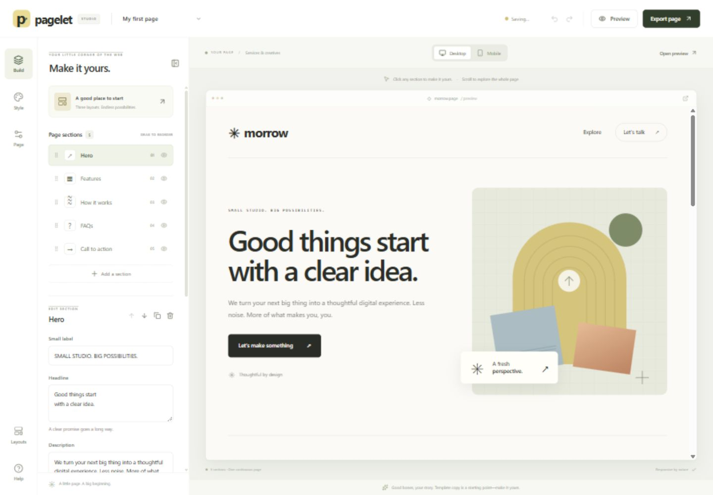
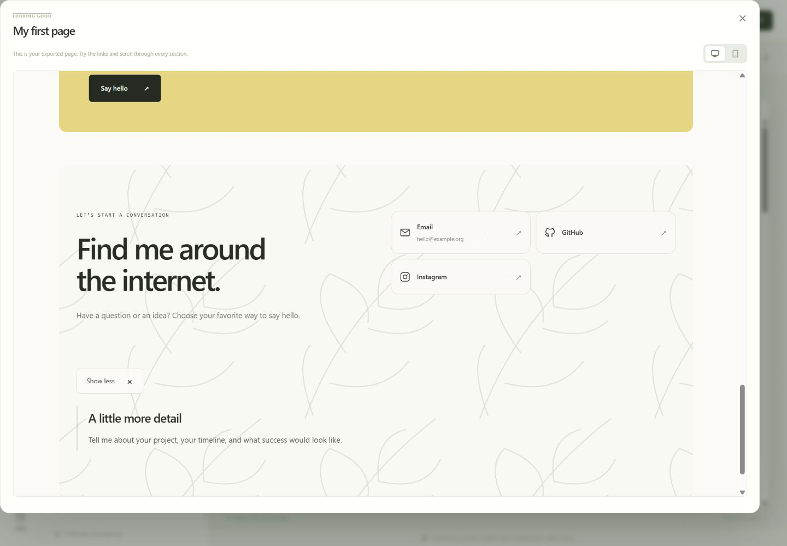
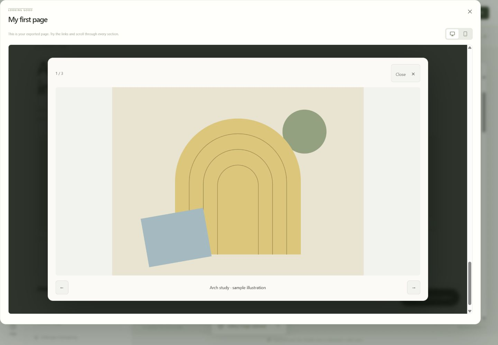

# Pagelet

**A little page. A big beginning.**



A focused landing page creator: choose a complete layout, make the story yours, and export a responsive website. Designed around scrolling sections and a clear call to action, with a small set of controls instead of an open-ended design canvas.

## What you can do

- Start with a goal: inquiries, product sales, events, or a portfolio; enter your brand, offer, and main destination to get a suggested section order
- Choose from six visual starters, including a product waitlist, photo mini-session booking page, and digital field guide with an interactive sample. Supply your own signup, booking, or checkout URL.
- Under **Section media**, choose **Place a photo or video**. Drag across sections, choose foreground or background, replace hero artwork, or drop onto a section CTA to use the upload as its skin. Use **Apply placement** to commit. Each section has one slot per supported role.
- Toggle **Snap to grid** for 10% steps, or hold Alt/Option while dragging for fine adjustment. The section picker, position sliders, and phone preview also work without dragging.
- Upload PNG, JPEG, or WebP images up to 1.5 MB and MP4 or WebM clips up to 12 MiB each. H.264 MP4 is the preferred format for Safari. Hero and foreground videos have playback controls. Background and button videos loop silently and respect reduced-motion settings. Media is embedded in HTML, website-folder exports, and project backups. Larger browser drafts use IndexedDB.
- Click headlines, descriptions, labels, and button text to edit directly; click outside the text or press Ctrl/⌘ Enter to save (Escape cancels)
- Choose Classic, Centered, or Compact section layouts
- Adjust mobile section visibility, heading sizes, and hero image crops independently of desktop
- Drag the hero image focal point, or use keyboard-accessible position sliders
- Try another coordinated look while keeping your content, then undo if you prefer the previous design
- Set page-wide button styles and spacing
- Review an actionable pre-export checklist, with links to the relevant section or settings
- Click a section in the preview to edit text, links, and hero imagery
- Add hero, features, how-it-works, testimonial, pricing, FAQ, closing CTA, and Contact sections
- Fill in email, phone, WhatsApp, LinkedIn, GitHub, Instagram, X, Facebook, YouTube, TikTok, and website fields; blank and invalid links stay hidden
- Use usernames or complete social URLs, plus up to six custom links for other platforms
- Upload a background image to any section, or choose from six built-in patterns and gradients
- Control fill/fit/repeat, image position, tile size, image opacity, blur, and overlay color/strength without fading text
- Add an optional expandable “Read more” block to any section, with editable text and a start-expanded option
- Add tabbed content with editable panels and arrow-key navigation
- Upload gallery images in batches, replace/reorder them, and open a captioned image viewer with next/previous controls
- Keep an optional contact button on screen, always or after scrolling, with a choice of corner and a phones-only option
- Drag sections to reorder them, or use accessible up/down buttons
- Duplicate, hide, and remove sections with undo/redo
- Change curated palettes, custom colors, typography, and corners
- Switch between scaled desktop and mobile previews
- Preview the complete scrolling page, including section links and expandable FAQs
- Save drafts locally and import/export editable JSON projects
- Export a single HTML file, or a ZIP folder containing index.html, styles.css, and page.js when interactive features need it; uploaded images stay embedded

Template names, copy, illustrations, and prices are examples. Customer testimonials begin as explicit prompts, never invented endorsements.

## A clearer starting point

Open **Start** (or the Pagelet logo) and choose what you want the page to do. Enter your name or brand, a one-sentence offer, and optionally a booking, checkout, registration, or contact link. Pagelet builds a suggested story from those choices. This is a local, rule-based starter; it does not send your input to an AI service. The rest of the starter copy is yours to replace. Pricing, dates, contact details, and images need your own content.

Select a section to choose **Classic**, **Centered**, or **Compact**. Main headings, descriptions, small labels, and button labels can be edited in the canvas. Changes commit when you leave the text, or with Ctrl/⌘ Enter. Escape cancels that text edit. List items and detailed settings remain available in the sidebar. Clicking a hero image opens image replacement.

Under **Mobile adjustments**, hide an individual section on small screens or override its heading size. Hero crop controls follow the selected Desktop/Mobile preview. Drag the marker or use the horizontal and vertical sliders. Mobile settings apply at widths up to 580px. Hiding a section keeps its content in the editable project; its HTML remains in exports with a responsive CSS visibility rule, so it is not a privacy feature.

**Style → Try another look** cycles the palette, font, and corners without replacing content. Button styles and page spacing apply throughout the page. Every design change participates in undo/redo.

**Export page** checks common unfinished details: missing button targets, broken section anchors, mobile-hidden destinations, starter text, empty contact sections, invalid entered social links, missing image descriptions, and base text contrast. Each result opens its editing location. Empty individual social fields are intentionally omitted. Image-background checks are prompts for visual review; the checklist is not a full accessibility or publishing certification.

## Contact, backgrounds, and expandable details

Choose **Contact & socials** from **Add a section**, then fill in the channels you use. Social icons appear automatically. Handles such as `@yourname` become full profile links. Empty fields and invalid links are omitted from the exported page. New starting layouts include an empty Contact section; existing drafts keep their section order and can add one when needed. `#contact` targets a visible Contact section, falling back to a closing CTA when there is no Contact section.

Select any section and use its **Background** shortcut. Choose a built-in pattern/gradient or **Your image** to upload a picture. **Repeat as a pattern** enables tile sizing; uploaded images retain their aspect ratio. Opacity and blur apply to the background image only. Overlay color and strength provide another way to keep text readable. These are section backgrounds, separate from the hero's foreground image.

The **Read more** shortcut enables extra content that visitors can open and close. The FAQ section also provides expandable answers. Both use native HTML `<details>` and `<summary>` and work with touch, mouse, and keyboard in the exported file, without a JavaScript runtime.



## Tabs, galleries, and a sticky next step

**Tabbed content** is available from **Add a section**. Edit each tab's label and content, then reorder or remove tabs. Visitors can switch with a click, Left/Right arrows, Home, or End. Without JavaScript, the exported tab contents remain readable as ordinary sections.

**Image gallery** supports up to 12 images per section, captions, image descriptions, two or three columns, batch upload, replacement, and reordering. Three built-in vector studies provide an explicitly illustrative starting point. Clicking a picture opens a larger viewer for that gallery. Previous/next buttons and arrow keys browse images; Escape or Close dismisses the viewer and restores focus to the image that opened it.

Enable **Sticky contact button** in the **Page** panel. Set its label and destination, choose bottom left or bottom right, and decide whether it is always visible or appears after scrolling 240 pixels. A phones-only option hides it on wider screens. `#contact` scrolls to the Contact section; email, phone, WhatsApp, booking, and other web links also work.



## Run locally

Use **Node.js 24** and npm. The included framework supports Node 22.13+, while the test command uses Node 24's built-in TypeScript support.

```sh
npm run install:ci
npm run dev
```

Open **http://127.0.0.1:5173**.

```sh
npm run typecheck
npm test
npm run build:static
```

`build:static` creates a standalone client-only build of **the creator** in `out/`. The pages created inside Pagelet export separately as individual HTML files.

For a single-file version of the creator that can be opened locally:

```sh
npm run build:offline
```

Open `out/pagelet-offline.html`. It includes the creator code and styles; no server or account is required. Browser storage behavior for local files varies, so keep JSON project backups. This offline artifact is separate from the landing pages you create.

`npm run build` also creates the static build; `npm start` previews it locally. The project retains its Vinext development setup and an optional `npm run build:worker` target. The configured Sites deployment uses the static output.

## Deploy the creator on GitHub Pages

1. Create a repository and upload this project's source to its root.
2. In **Settings → Pages**, choose **GitHub Actions** as the source.
3. In **Settings → Secrets and variables → Actions → Variables**, add `ENABLE_PAGES` with the value `true`.
4. Push to `main` or run **Check and deploy Pagelet** from the Actions tab. The workflow checks types, runs tests, builds `out/`, and deploys it.

Without `ENABLE_PAGES=true`, pushes still run the checks and build, while deployment stays off. This keeps a fresh repository usable before Pages hosting is configured.

No API keys or backend are needed for the static build. Relative asset paths support repository subpaths such as `https://YOUR-USERNAME.github.io/pagelet/`.

See [GitHub's Pages publishing documentation](https://docs.github.com/en/pages/getting-started-with-github-pages/configuring-a-publishing-source-for-your-github-pages-site). The workflow uses the official [checkout](https://github.com/actions/checkout), [setup-node](https://github.com/actions/setup-node), [upload-pages-artifact](https://github.com/actions/upload-pages-artifact), and [deploy-pages](https://github.com/actions/deploy-pages) actions.

## Export a landing page

Use **Export page → Download your page**. Open the resulting HTML file directly in a browser, or rename it to `index.html` and upload it to any static host. Exported pages need no editor account, external fonts, CDN, or framework. Tabs, galleries, and scroll-triggered sticky buttons include a small inline JavaScript runtime when used. FAQ and “Read more” disclosures use native HTML. Uploaded images and built-in illustrations are embedded.

Buttons link to the destinations you provide. Set your own email, booking, checkout, or signup URL. There is no built-in payment processor, form backend, analytics, or A/B testing service.

For separate website files, choose **Download HTML / CSS / JS folder (.zip)**. Extract the ZIP and keep its files together. It includes an index.html, styles.css, a page.js only when required, and a short README. Images stay embedded in the HTML or CSS.

Download a **project backup** if you want to edit the page later. The HTML export is the finished site, not the editable project format.

## Why sections, rather than a fixed canvas?

Landing pages can span many screens. Pagelet treats them as an ordered story: introduce the offer, explain its value, answer questions, and make the next step clear. Optional pricing and testimonial sections support pages that need more information.

Research informed the controls, not a promise of conversion performance:

- [Apexure's IMD case study](https://www.apexure.com/case-study/landing-page-optimization-case-study/) reports conversion increasing from 3.91% to 6.38% after moving video testimonials and About content higher. This supports making section order easy to change. The published case study does not give test duration or download counts.
- [Corcentric's VWO/Wingify case study](https://wingify.com/success-stories/corcentric/) reports a 99% increase in CTA click-through after clarifying the offer. Click-through is a different metric from purchases or qualified leads.
- [Linear](https://linear.app/) and [Stripe Payments](https://stripe.com/payments) were inspected as examples of multi-section product storytelling, not as evidence of publicly verified conversion rates.

Page length, section order, and CTA wording should be tested with the actual audience. Pagelet does not label any template as guaranteed to convert.

## Source map

| File | Purpose |
| --- | --- |
| `components/studio.tsx` | Editor, browser persistence, history, dialogs, file handling |
| `lib/page-guidance.ts` + `components/page-guidance.tsx` | Goal starters, pre-export checks, mobile controls, and image focal points |
| `lib/layout-styles.ts` + `lib/editor-bridge.ts` | Responsive layout overrides and editor-only inline editing |
| `lib/export-bundle.ts` | Separate website assets and dependency-free ZIP export |
| `lib/page-model.ts` | Project schema, templates, section operations, import validation |
| `lib/render-page.ts` | Shared preview/export renderer, escaping, URL allowlists |
| `lib/section-content.ts` | Contact icons, background layers, and native expandable details |
| `lib/socials.ts` + `lib/backgrounds.ts` | Social link normalization and bounded background settings |
| `lib/interactive-model.ts` + `lib/interactive-content.ts` | Gallery/sticky settings, tabs, the image viewer, and conditional export behavior |
| `components/section-settings.tsx` | Contact, background, and expandable-details editor controls |
| `components/interactive-settings.tsx` | Tab, gallery upload, and sticky contact controls |
| `app/globals.css` | Responsive editor interface |
| `static/` + `vite.static.config.ts` | Portable GitHub Pages entry point |
| `app/` + `vite.config.ts` | Vinext entry point and Sites hosting integration |
| `tests/` | Project, import migration, contact, background, disclosure, and export behavior tests |

## Persistence and limits

- One active browser draft; no account or cross-device sync
- Undo/redo keeps up to 60 document states in memory; history resets on reload
- Up to 30 sections and 12 items per section
- Up to eight tabs per tabbed section and 12 images per gallery
- Each raster image may use up to 1.5 MB and each MP4 or WebM video up to 12 MiB. Editable project imports accept up to 128 MB.
- Browser storage quotas vary. If saving fails, Pagelet prompts you to download a backup.
- Preview content runs in sandboxed iframes. External links open a separate tab in full preview. Social website links also open a separate tab in exports; other exported links retain normal native behavior.
- Text and metadata are escaped; imported themes and section types are validated; link and image protocols are restricted.

## Possible next steps

Multiple saved projects, more section-specific layouts, hosted publishing, and optional measurement integrations. The current version stays focused on creating and exporting one complete page.

## License

MIT. See [LICENSE](LICENSE).

## Validation

Run `npm run typecheck`, `npm test`, and `npm run build:offline` to check the editor and build its portable HTML file. Tests cover templates, section placement, grid snapping, backup migration, embedded media, and website-folder exports.
